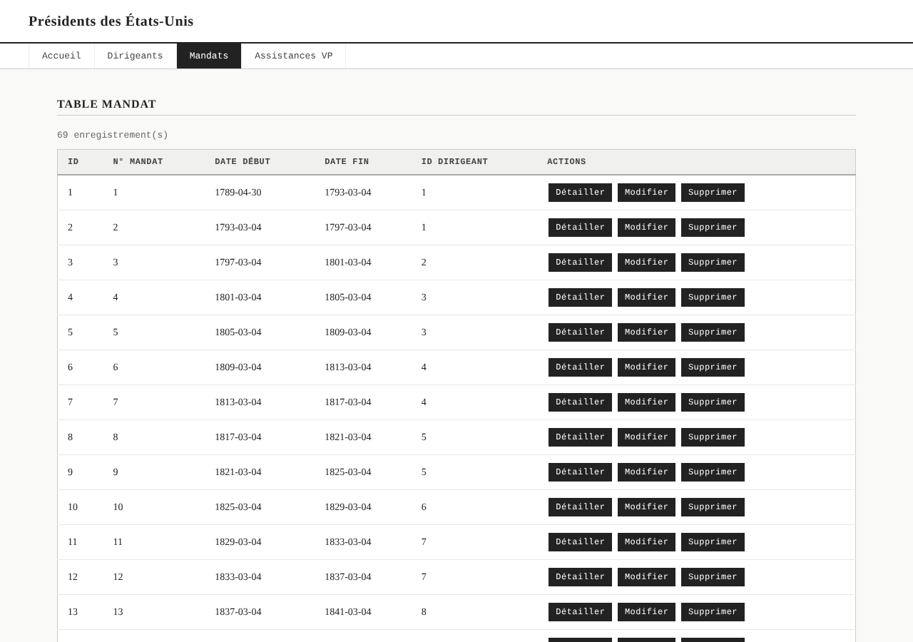
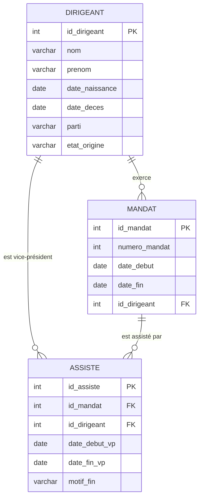
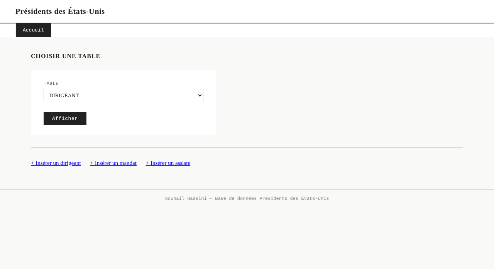
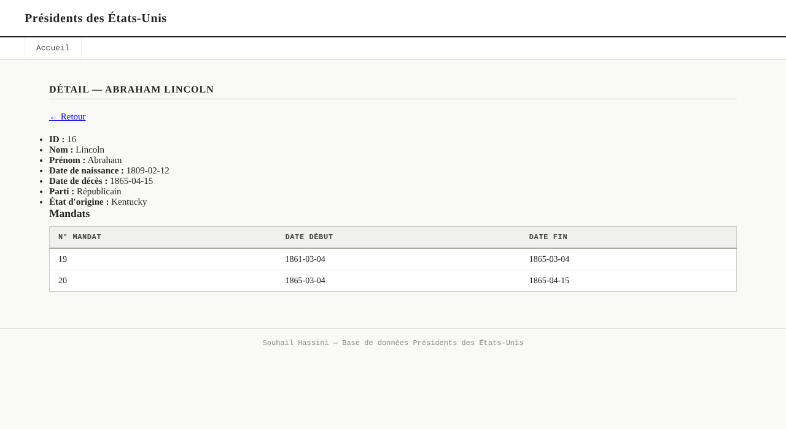
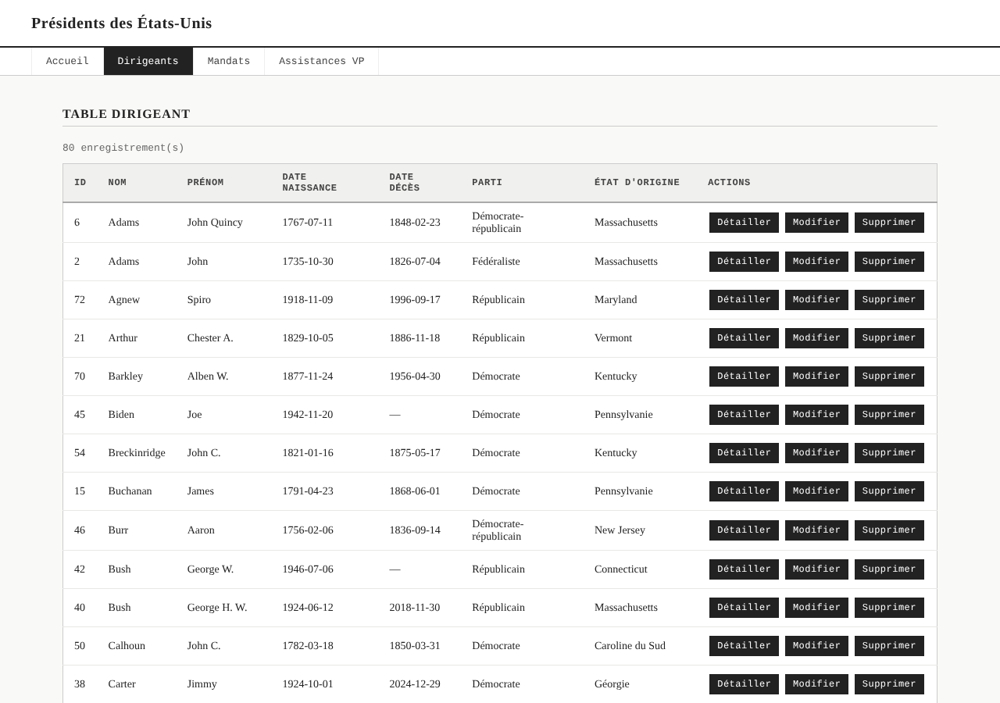
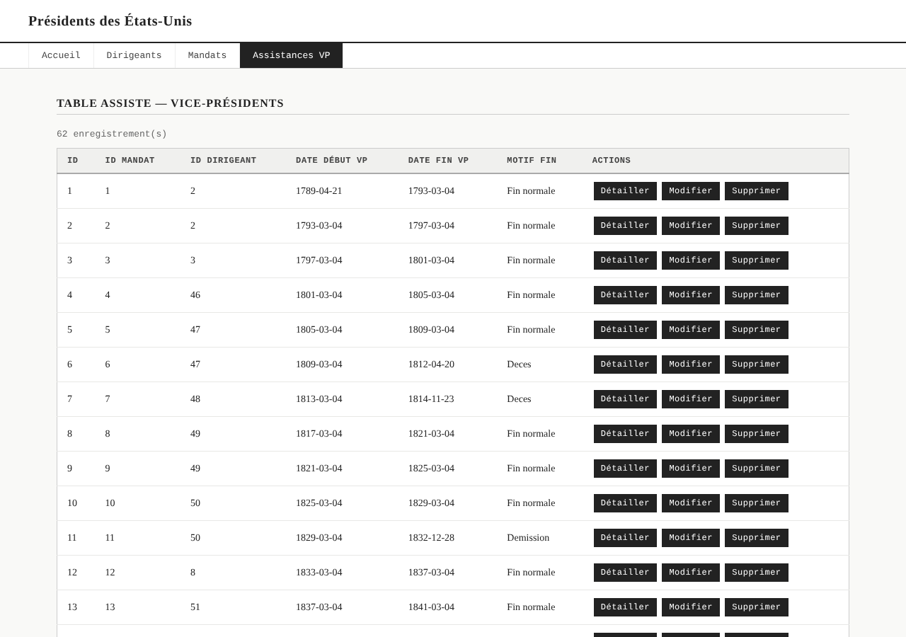

# BDD Web Présidents USA – Base de données PostgreSQL et application web PHP

Projet universitaire individuel de **Licence 2 Informatique** (Université Le Havre Normandie, 2025-2026) :
modélisation d'une base de données relationnelle des présidents et vice-présidents américains, puis développement d'un site web
en **PHP** permettant de consulter et de modifier toutes ses tables (CRUD).



## Fonctionnalités

- Page d'accueil avec choix de la table à afficher (mémorisé en **session**)
- Affichage du contenu de chaque table, avec trois actions par ligne : **détailler**, **modifier**, **supprimer**
- Page de détail enrichie des données liées par clés étrangères (ex. : les mandats d'un président)
- Formulaires d'**insertion** et de **modification** pour chaque table
- Suppression en cascade cohérente (un dirigeant supprimé entraîne ses mandats et vice-présidences)
- Requêtes **préparées** avec PDO (protection contre les injections SQL) et échappement HTML à l'affichage
- Pour chaque table : un fichier de fonctions d'accès aux données et un fichier de test

## Technologies

PHP 8 · PDO · PostgreSQL · SQL · HTML5 · CSS3

## Modèle de données



- **DIRIGEANT** : toute personne ayant été président et/ou vice-président (80 personnes).
- **MANDAT** : une période d'exercice d'un président (69 lignes, du mandat n° 1 en 1789 au n° 60 en 2025). Quand un président meurt ou démissionne, son successeur termine le même mandat électoral : les deux lignes partagent alors le même `numero_mandat`.
- **ASSISTE** : un vice-président auprès d'un président, avec le motif de fin (fin normale, décès, démission, succession, en cours).

Le jeu de données couvre l'ensemble des 45 présidents et 50 vice-présidents, de George Washington à aujourd'hui.

## Structure du dépôt

```
├── sql/
│   ├── 01_schema.sql            création des tables et contraintes
│   ├── 02_donnees.sql           données de 1789 à 2025
│   └── 03_requetes_exemples.sql 10 requêtes d'analyse (durées au pouvoir, successions…)
├── site/
│   ├── index.php                accueil et choix de la table
│   ├── bd_connexion.php         connexion PDO
│   ├── config.example.php       modèle de configuration
│   ├── style.css
│   ├── dirigeant/               fonctions, liste, détail, insertion, modification
│   ├── mandat/
│   └── assiste/
├── captures/                    captures d'écran du site
└── docs/mode_emploi.md          utilisation du site
```

## Installation

1. Créer une base PostgreSQL puis exécuter les scripts dans l'ordre :
   ```bash
   psql -U votre_utilisateur -d presidents_usa -f sql/01_schema.sql
   psql -U votre_utilisateur -d presidents_usa -f sql/02_donnees.sql
   ```
2. Copier `site/config.example.php` en `site/config.php` et y renseigner vos identifiants.
3. Lancer le serveur PHP intégré :
   ```bash
   cd site
   php -S localhost:8000
   ```
4. Ouvrir <http://localhost:8000> dans le navigateur.

## Captures d'écran

| Accueil | Détail d'un président |
| --- | --- |
|  |  |

| Liste des dirigeants | Vice-présidences |
| --- | --- |
|  |  |

## Auteur

Souhail Hassini – [GitHub](https://github.com/souhail-hassini) · [LinkedIn](https://www.linkedin.com/in/souhail-hassini-628244222/)

---

## English summary

Individual university project (2nd year, BSc Computer Science, Université Le Havre Normandie). I designed a relational database of
every U.S. president and vice president since 1789, then built a PHP web application to browse and edit it: table selection
stored in session, full CRUD on each table, detail pages with related records, prepared PDO statements and HTML escaping.
**Stack:** PHP 8, PDO, PostgreSQL, SQL, HTML, CSS. See *Installation* above to run it locally.
